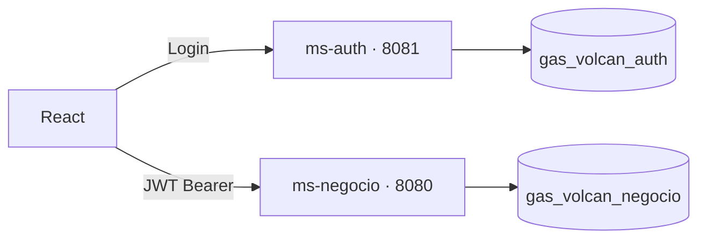

# Gas El Volcán · ms-negocio

Servicio Spring Boot de catálogo, stock, pedidos y despacho. El frontend consume esta API REST y obtiene la sesión desde `ms-auth`. Cada servicio tiene su propio `pom.xml`, proceso y esquema MySQL.



- [Frontend React · rama de integración](https://github.com/Croix77/GasvolcanReact/tree/feat/integracion-parcial-3)
- [ms-auth · rama de integración](https://github.com/Croix77/GasVolcanAuth/tree/feat/ms-auth-parcial-3)

## Ejecutar en local

1. Con Java 17 y MySQL activo, crea el esquema `gas_volcan_negocio` y una cuenta MySQL con permisos sobre ese esquema. Activa `ms-auth` con su propia base y configura el primer administrador según su README.
2. En PowerShell, desde la carpeta de este servicio, configura `JWT_SECRET` con el mismo valor Base64 que en `ms-auth` y ejecuta:

```powershell
$clave = Read-Host "Contraseña de MySQL para ms-negocio" -AsSecureString
$env:DB_PASSWORD = [System.Net.NetworkCredential]::new("", $clave).Password
$env:APP_SEED_CATALOGO = "true"
.\mvnw.cmd spring-boot:run
```

El servicio escucha en `http://localhost:8080`. La carga inicial agrega 14 productos en cuatro categorías y conserva los cambios en una base con productos existentes. Las cinco zonas provienen del catálogo del caso. Para una base con datos propios, configura `APP_SEED_CATALOGO=false`.

| Variable | Uso |
| --- | --- |
| `DB_URL` | Por defecto `jdbc:mysql://127.0.0.1:3306/gas_volcan_negocio` |
| `DB_USER` | Por defecto `gas_volcan_app` |
| `DB_PASSWORD` | Contraseña MySQL requerida |
| `JWT_SECRET` | Clave compartida con `ms-auth`, Base64 de al menos 32 bytes |
| `JWT_ISSUER` | `gasvolcan-auth` |
| `PORT` | `8080` por defecto |
| `APP_CORS_ORIGINS` | Orígenes explícitos, separados por comas. En local habilita Vite en el puerto 5173 |
| `DB_DDL_AUTO` | `update` en local y `validate` en el perfil `prod` |
| `SWAGGER_ENABLED` | `true` en local y `false` en `prod` |

## API y permisos

[Swagger UI local](http://localhost:8080/swagger-ui/index.html) entrega el contrato en `/v3/api-docs`. Usa **Authorize** con el token de `POST /api/auth/login`. Puedes importar `http://localhost:8080/v3/api-docs` directamente en Postman.

| Método y recurso | Acceso |
| --- | --- |
| GET `/api/v1/productos`, `/api/v1/categorias` y sus detalles | ADMIN, VENDEDOR y CLIENTE |
| POST, PUT y DELETE de productos o categorías | ADMIN |
| GET `/api/v1/zonas` | ADMIN, VENDEDOR y CLIENTE |
| POST `/api/v1/pedidos` | CLIENTE. Envía datos de entrega, latitud/longitud e ítems con `id` y `cantidad` |
| GET `/api/v1/pedidos` y `/api/v1/pedidos/{id}` | CLIENTE solo sus pedidos, REPARTIDOR solo asignados. ADMIN, OPERADORA y VENDEDOR pueden consultar los pedidos. El listado admite `?fecha=AAAA-MM-DD` en el horario de Chile |
| PATCH `/api/v1/pedidos/{id}/asignacion` | ADMIN y OPERADORA. Envía `correoRepartidor` elegido en el listado de `ms-auth` |
| PATCH `/api/v1/pedidos/{id}/estado` | ADMIN, OPERADORA o el REPARTIDOR asignado. `EN_CAMINO` o `ENTREGADO` |
| PUT `/api/v1/pedidos/{id}/ubicacion` | ADMIN o el REPARTIDOR asignado. Envía `latitud` y `longitud` durante el recorrido |

El pedido admite tres unidades de cada producto. El servidor calcula los precios, guarda el total y descuenta el stock en una sola transacción. La referencia de compra permite reintentar una solicitud sin volver a descontar stock. La entrega registra el efectivo. El estado de una sesión de Auth se consulta al renovar. Negocio valida firma, emisor, vigencia y rol localmente y un JWT ya emitido conserva sus permisos allí hasta vencer, según el flujo de la Guía 17. El asignador selecciona al repartidor activo desde React. La API de negocio comprueba los permisos de quien asigna y el correo del repartidor en las solicitudes posteriores. La lista de repartidores activos se consulta en Auth desde React.

Las ediciones de productos deben incluir el campo `version` que devolvió la consulta. Si hubo una compra u otra edición desde entonces, el servidor devuelve `409`. Consulta los datos actuales antes de volver a editar. Al quitar un producto, los pedidos anteriores conservan sus artículos. Las categorías con productos asociados se protegen del borrado.

## Pruebas

```powershell
.\mvnw.cmd verify
```

Las pruebas HTTP de Maven usan una base H2 aislada. Incluyen autenticación, CRUD, reglas de inventario, estado del pedido y permisos. El JAR generado es `target/ms-negocio-0.0.1-SNAPSHOT.jar`. La configuración de referencia para AWS está en [despliegue-ec2.md](deploy/despliegue-ec2.md).
